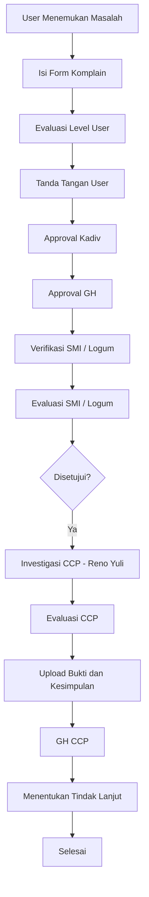

# PRODUCT REQUIREMENTS DOCUMENT (PRD)
## Sistem Informasi Komplain Vendor

**Versi:** 1.0  
**Status:** Draft  
**Modul:** Vendor Complaint Management  
**Platform:** Web Application

---

# 1. Project Overview

## 1.1 Latar Belakang

Dalam operasional rumah sakit, terdapat kemungkinan terjadinya permasalahan terhadap barang, jasa, maupun vendor yang bekerja sama dengan rumah sakit.

Permasalahan tersebut dapat ditemukan oleh berbagai unit atau departemen, kemudian perlu dilaporkan, diverifikasi, dievaluasi, dan ditindaklanjuti oleh pihak terkait.

Proses penanganan komplain membutuhkan alur persetujuan berjenjang yang melibatkan User, Kepala Divisi (Kadiv), Group Head (GH), SMI/Logum, CCP, hingga GH CCP.

Oleh karena itu, diperlukan sebuah sistem informasi yang dapat mengelola seluruh proses komplain vendor secara terintegrasi, mulai dari pelaporan hingga keputusan tindak lanjut.

## 1.2 Tujuan Sistem

1. Mempermudah karyawan dalam melaporkan permasalahan vendor.
2. Menstandarkan proses pengajuan dan persetujuan komplain.
3. Memfasilitasi proses evaluasi pada setiap tahapan.
4. Mendokumentasikan hasil investigasi dan tindak lanjut.
5. Memudahkan monitoring status komplain.
6. Menyediakan riwayat penanganan komplain sebagai bahan evaluasi vendor.
7. Menyediakan laporan komplain berdasarkan unit kerja, vendor, jenis permasalahan, dan status penanganan.

## 1.3 Target Pengguna

Sistem digunakan oleh:

- User/Pelapor.
- Kepala Divisi (Kadiv).
- Group Head (GH).
- SMI.
- Logistik Umum (Logum).
- Tim CCP (Reno Yuli).
- GH CCP.
- Administrator Sistem.

---

# 2. Scope of System

## 2.1 Ruang Lingkup Pengembangan

Sistem mencakup beberapa modul utama:

1. Dashboard.
2. Form Komplain Vendor.
3. Approval Komplain.
4. Evaluasi User.
5. Verifikasi SMI/Logum.
6. Investigasi CCP.
7. Tindak Lanjut GH CCP.
8. Master Data.
9. Manajemen Pengguna dan Hak Akses.
10. Riwayat dan Laporan Komplain.

## 2.2 Di Luar Ruang Lingkup

Untuk tahap pengembangan awal, sistem belum mencakup:

- Integrasi otomatis dengan sistem pengadaan.
- Integrasi otomatis dengan sistem penilaian performa vendor.
- Pengiriman komplain langsung kepada vendor.
- Proses penggantian vendor secara otomatis.

Keputusan tindak lanjut hanya dicatat dan didokumentasikan melalui sistem.

---

# 3. User Role & Permission

Sistem menerapkan Role-Based Access Control (RBAC), sehingga setiap pengguna hanya dapat mengakses fitur sesuai tanggung jawabnya.

| Role | Hak Akses dan Tanggung Jawab |
|---|---|
| User/Pelapor | Membuat komplain, mengisi evaluasi awal, melihat status laporan sendiri, dan melakukan tanda tangan |
| Kadiv | Melihat laporan dari unit terkait, melakukan pemeriksaan, dan tanda tangan persetujuan |
| GH Terkait | Memeriksa laporan dan memberikan tanda tangan persetujuan |
| SMI/Logum | Melakukan verifikasi, evaluasi, memberikan keterangan, dan persetujuan |
| CCP | Melakukan investigasi, mengisi evaluasi, mengunggah bukti, dan membuat kesimpulan |
| GH CCP | Melihat hasil investigasi dan menentukan tindak lanjut |
| Administrator | Mengelola master data, parameter evaluasi, pengguna, role, dan konfigurasi sistem |

### 3.1 Ketentuan Akses

- User hanya dapat membuat laporan dan melihat laporan miliknya.
- Kadiv hanya dapat memproses laporan yang menjadi tanggung jawabnya.
- GH hanya dapat memproses laporan sesuai cakupan kewenangannya.
- SMI/Logum hanya dapat memproses laporan yang masuk ke unitnya.
- Investigasi CCP ditugaskan kepada Reno Yuli.
- GH CCP memiliki akses untuk menentukan keputusan tindak lanjut.
- Administrator memiliki akses konfigurasi tanpa otomatis memiliki kewenangan menyetujui laporan.

---

# 4. Business Process / Workflow

## 4.1 Alur Utama Sistem

Alur proses komplain vendor:

**User → Kadiv → GH → SMI/Logum → CCP (Reno Yuli) → GH CCP**

### Tahap 1 – Pelaporan oleh User

User yang menemukan permasalahan melakukan pengisian Form Komplain Vendor.

Aktivitas:

- Mengisi data pelapor.
- Mengisi data barang atau jasa.
- Memilih jenis komplain.
- Mengisi parameter evaluasi level User.
- Mengunggah dokumen pendukung.
- Melakukan tanda tangan digital.
- Mengirimkan laporan.

### Tahap 2 – Approval Kadiv

- Kadiv menerima notifikasi laporan baru.
- Kadiv memeriksa detail komplain.
- Kadiv memberikan tanda tangan persetujuan.

### Tahap 3 – Approval GH

- Setelah disetujui Kadiv, laporan masuk ke GH terkait.
- GH memeriksa informasi laporan.
- GH memberikan tanda tangan persetujuan.

### Tahap 4 – Verifikasi SMI/Logum

- Laporan diteruskan ke SMI/Logum sesuai penugasan.
- SMI/Logum melakukan pemeriksaan dan konfirmasi.
- SMI/Logum mengisi parameter evaluasi sesuai master evaluasi.
- SMI/Logum mengisi hasil verifikasi dan memberikan persetujuan.
- Setelah disetujui, laporan diteruskan ke CCP.

### Tahap 5 – Investigasi CCP (Reno Yuli)

- Laporan diterima oleh CCP.
- Penugasan investigasi diberikan kepada Reno Yuli.
- CCP memeriksa laporan dan hasil verifikasi sebelumnya.
- CCP mengisi parameter evaluasi level CCP.
- CCP melakukan investigasi.
- CCP mengunggah bukti investigasi.
- CCP mengisi hasil dan kesimpulan investigasi.
- Setelah investigasi selesai, laporan diteruskan ke GH CCP.

### Tahap 6 – Tindak Lanjut GH CCP

- GH CCP menerima laporan hasil investigasi.
- GH CCP memeriksa hasil investigasi.
- GH CCP menentukan keputusan tindak lanjut.
- GH CCP mengisi keterangan keputusan.
- Sistem menyimpan keputusan dan mengubah status laporan menjadi Selesai.

## 4.2 Diagram Alur

**Catatan:** Penanganan apabila laporan ditolak atau perlu revisi akan mengikuti aturan bisnis yang ditetapkan rumah sakit.

---

# 5. Functional Requirements

## 5.1 Modul Dashboard

Dashboard menampilkan informasi ringkas mengenai komplain vendor.

Informasi yang ditampilkan:

- Total komplain.
- Komplain menunggu approval.
- Komplain menunggu verifikasi SMI/Logum.
- Komplain dalam investigasi CCP.
- Komplain menunggu tindak lanjut GH CCP.
- Komplain selesai.
- Grafik jumlah komplain berdasarkan periode.
- Grafik komplain berdasarkan jenis permasalahan.

Dashboard menyesuaikan data yang dapat diakses berdasarkan role pengguna.

## 5.2 Modul Form Komplain Vendor

Form ini digunakan oleh User/Pelapor untuk mencatat permasalahan vendor.

### Section A – Data Pelapor

| Field | Tipe Input | Sumber Data | Mandatory |
|---|---|---|---|
| Nama Pelapor | Otomatis/Read Only | Master Karyawan | Ya |
| Unit Kerja | Dropdown | Master Unit Kerja | Ya |
| Jabatan | Dropdown | Master Jabatan | Ya |
| Tanggal Pelaporan | Otomatis | Sistem | Ya |

Nama pelapor dapat mengambil data dari akun pengguna yang sedang login.

Unit kerja dan jabatan menggunakan master data yang telah tersedia.

### Section B – Data Barang/Jasa

| Field | Tipe Input | Mandatory |
|---|---|---|
| Nama Barang/Jasa | Free Text | Ya |
| Jenis | Free Text | Ya |
| Merek | Free Text | Ya |
| Nama Distributor | Free Text | Ya |

Seluruh kolom diisi secara manual oleh pelapor. Nama barang, jenis, merek, dan distributor tidak menggunakan master data pada tahap awal.

### Section C – Detail Komplain

| Field | Tipe Input | Mandatory |
|---|---|---|
| Jenis Komplain | Dropdown Master | Ya |
| Deskripsi Komplain | Textarea | Ya |
| Dokumen Pendukung | Upload Foto/PDF | Ya |

Ketentuan:

- Jenis komplain menggunakan master data.
- User hanya dapat memilih satu jenis komplain.
- Deskripsi digunakan untuk menjelaskan kronologi atau kondisi permasalahan.
- Dokumen pendukung dapat berupa foto atau PDF.
- Sistem mendukung pengunggahan lebih dari satu dokumen.

### Section D – Evaluasi Level User

Sistem menampilkan parameter evaluasi berdasarkan master evaluasi level User.

Ketentuan:

- Parameter ditampilkan secara dinamis berdasarkan master.
- User wajib mengisi seluruh parameter evaluasi aktif.
- Jawaban dan hasil evaluasi disimpan sebagai bagian dari laporan komplain.

### Section E – Persetujuan dan Tanda Tangan

Menampilkan informasi dan proses tanda tangan:

1. Tanda tangan User.
2. Tanda tangan Kadiv.
3. Tanda tangan GH.

Setiap tanda tangan harus memiliki rekam waktu dan identitas pengguna yang melakukan persetujuan.

## 5.3 Modul Approval Kadiv dan GH

Fitur:

- Daftar laporan yang menunggu persetujuan.
- Detail laporan komplain.
- Melihat dokumen pendukung.
- Melihat evaluasi dari User.
- Memberikan persetujuan.
- Melakukan tanda tangan digital.
- Menambahkan catatan persetujuan.

Persetujuan dilaksanakan secara berurutan, yaitu Kadiv terlebih dahulu kemudian GH.

## 5.4 Modul Evaluasi SMI/Logum

Fitur:

- Menampilkan laporan yang telah mendapatkan persetujuan GH.
- Menampilkan detail laporan dan dokumen pendukung.
- Mengisi parameter evaluasi level SMI/Logum.
- Menambahkan hasil konfirmasi.
- Mengunggah dokumen pendukung apabila diperlukan.
- Memberikan persetujuan untuk meneruskan laporan ke CCP.

Hasil evaluasi dan verifikasi harus tersimpan dalam riwayat laporan.

## 5.5 Modul Investigasi CCP

Investigasi dilakukan oleh petugas CCP yang ditentukan, yaitu Reno Yuli.

Fitur:

- Daftar komplain yang telah disetujui SMI/Logum.
- Detail laporan dan histori persetujuan.
- Melihat hasil evaluasi User.
- Melihat hasil evaluasi SMI/Logum.
- Mengisi parameter evaluasi level CCP.
- Mengunggah dokumen hasil investigasi.
- Mengisi keterangan investigasi.
- Mengisi kesimpulan investigasi.
- Menyelesaikan tahap investigasi dan meneruskan laporan ke GH CCP.

Status investigasi:

- Dalam Investigasi.
- Selesai Investigasi.

Pada tahap ini, hanya petugas CCP yang berwenang yang dapat mengisi atau mengubah data investigasi.

## 5.6 Modul Tindak Lanjut GH CCP

GH CCP menerima laporan setelah investigasi selesai.

Fitur:

- Melihat detail komplain.
- Melihat hasil evaluasi seluruh tahapan.
- Melihat hasil dan dokumen investigasi CCP.
- Menentukan tindak lanjut.
- Mengisi keterangan tindak lanjut.
- Menyimpan keputusan akhir.

Pilihan tindak lanjut:

| No. | Keputusan | Keterangan |
|---|---|---|
| 1 | Ganti Vendor | Mengganti vendor yang digunakan |
| 2 | Ganti Merek | Mengganti merek barang |
| 3 | Ganti Barang | Mengganti barang yang bermasalah |
| 4 | Tetap Melanjutkan Kerja Sama | Mempertahankan kerja sama dengan vendor |
| 5 | Lainnya | Keputusan lain yang diisi menggunakan Free Text |

Keterangan tindak lanjut wajib diisi untuk menjelaskan keputusan yang diambil.

Setelah keputusan disimpan, laporan berubah menjadi status Selesai.

---

# 6. Master Data Management

Sistem menyediakan pengelolaan master data secara dinamis.

## 6.1 Master Unit Kerja

Digunakan untuk pilihan unit kerja pelapor.

Field:

- ID.
- Nama Unit Kerja.
- Status Aktif/Nonaktif.

## 6.2 Master Jabatan

Digunakan untuk pilihan jabatan pelapor dan referensi proses approval.

Field:

- ID.
- Nama Jabatan.
- Status Aktif/Nonaktif.

## 6.3 Master Jenis Komplain

Digunakan untuk pilihan kategori permasalahan yang dilaporkan oleh User.

Field:

- ID.
- Nama Jenis Komplain.
- Deskripsi.
- Status Aktif/Nonaktif.

## 6.4 Master Parameter Evaluasi

Master parameter evaluasi merupakan komponen penting sistem.

Parameter evaluasi dibedakan menjadi tiga kelompok:

1. Evaluasi Level User.
2. Evaluasi Level SMI/Logum.
3. Evaluasi Level CCP.

### Struktur Master Parameter Evaluasi

| Field | Keterangan |
|---|---|
| ID | Identitas parameter |
| Level Evaluasi | User / SMI-Logum / CCP |
| Nama Parameter | Nama indikator evaluasi |
| Deskripsi | Penjelasan indikator |
| Tipe Jawaban | Pilihan / Ya-Tidak / Angka / Teks |
| Wajib Diisi | Ya / Tidak |
| Urutan | Urutan tampilan |
| Status | Aktif / Nonaktif |

Ketentuan:

- Administrator dapat menambah parameter baru.
- Administrator dapat mengubah parameter yang tersedia.
- Parameter dapat diaktifkan atau dinonaktifkan.
- Parameter dapat diurutkan sesuai kebutuhan.
- Setiap level memiliki parameter masing-masing.
- Perubahan master tidak boleh mengubah jawaban evaluasi dari laporan lama.

Jika menggunakan metode penilaian berbobot atau skor, sistem perlu menyediakan pengaturan bobot dan perhitungan skor sebagai pengembangan lanjutan setelah formula penilaian disepakati.

---

# 7. Status Management

Sistem menggunakan status untuk menggambarkan posisi laporan dalam workflow.

| No. | Status | Keterangan |
|---|---|---|
| 1 | Draft | Laporan masih dalam pengisian |
| 2 | Menunggu Approval Kadiv | Menunggu persetujuan Kadiv |
| 3 | Menunggu Approval GH | Menunggu persetujuan GH |
| 4 | Menunggu Verifikasi SMI/Logum | Menunggu pemeriksaan SMI/Logum |
| 5 | Menunggu Investigasi CCP | Menunggu penanganan CCP |
| 6 | Dalam Investigasi | Sedang dilakukan investigasi |
| 7 | Menunggu Tindak Lanjut GH CCP | Menunggu keputusan GH CCP |
| 8 | Selesai | Keputusan tindak lanjut telah ditetapkan |

Status tambahan untuk kondisi penolakan atau revisi dapat ditambahkan setelah aturan proses bisnis ditetapkan.

---

# 8. Notification System

Sistem perlu menyediakan notifikasi kepada pengguna ketika terdapat tugas atau perubahan status laporan.

| Event | Penerima |
|---|---|
| Laporan baru diajukan | Kadiv |
| Laporan disetujui Kadiv | GH |
| Laporan disetujui GH | SMI/Logum |
| Laporan disetujui SMI/Logum | CCP (Reno Yuli) |
| Investigasi selesai | GH CCP |
| Keputusan tindak lanjut ditetapkan | User/Pelapor, Kadiv, GH terkait |

Jenis notifikasi:

- Notifikasi dalam aplikasi.
- Notifikasi email sebagai kanal tambahan.

Setiap notifikasi memuat nomor laporan, informasi singkat komplain, status terbaru, dan tautan menuju detail laporan.

---

# 9. Reporting & Monitoring

Sistem menyediakan fitur laporan dan rekapitulasi komplain.

## 9.1 Daftar Komplain

Informasi yang ditampilkan:

- Nomor Komplain.
- Tanggal Laporan.
- Nama Pelapor.
- Unit Kerja.
- Jabatan.
- Nama Barang/Jasa.
- Jenis.
- Merek.
- Distributor.
- Jenis Komplain.
- Status.
- Keputusan Tindak Lanjut.

## 9.2 Filter Laporan

Pengguna dapat melakukan penyaringan berdasarkan:

- Periode tanggal.
- Unit kerja.
- Nama pelapor.
- Nama distributor.
- Nama barang.
- Jenis komplain.
- Status laporan.
- Keputusan tindak lanjut.

## 9.3 Rekapitulasi

Sistem menyediakan informasi:

- Jumlah komplain per periode.
- Jumlah komplain per unit kerja.
- Jumlah komplain per distributor.
- Jumlah komplain berdasarkan jenis komplain.
- Jumlah komplain berdasarkan status.
- Rekapitulasi keputusan tindak lanjut.

## 9.4 Export Data

Sistem menyediakan fasilitas ekspor laporan ke:

- Excel.
- PDF.

---

# 10. Audit Trail & Documentation

Seluruh aktivitas penting dalam sistem harus tercatat.

Aktivitas yang dicatat:

- Pembuatan laporan.
- Perubahan data laporan.
- Tanda tangan User.
- Persetujuan Kadiv.
- Persetujuan GH.
- Aktivitas verifikasi SMI/Logum.
- Aktivitas investigasi CCP.
- Upload dan penghapusan dokumen.
- Keputusan tindak lanjut GH CCP.
- Perubahan status.

Informasi log minimal:

- Pengguna.
- Aktivitas.
- Tanggal dan waktu.
- Data sebelum dan sesudah perubahan jika ada.

Riwayat aktivitas digunakan sebagai dokumentasi dan bukti proses penanganan komplain.

---

# 11. Non-Functional Requirements

## 11.1 Security

- Sistem menerapkan autentikasi pengguna.
- Sistem menerapkan RBAC.
- Setiap proses dibatasi berdasarkan kewenangan.
- Dokumen pendukung tidak dapat diakses tanpa otorisasi.
- Password disimpan menggunakan mekanisme hashing.
- Aktivitas penting tersimpan di audit trail.

## 11.2 Data Validation

- Seluruh field wajib pada form harus divalidasi.
- Sistem tidak mengizinkan pengajuan apabila data wajib belum lengkap.
- File upload hanya menerima format yang diizinkan, yaitu foto dan PDF.
- Sistem melakukan validasi tipe dan ukuran file.
- Tanda tangan harus terhubung dengan identitas pengguna yang melakukan tindakan.

## 11.3 Performance

- Halaman utama dan daftar laporan harus dapat dimuat secara efisien.
- Data laporan menggunakan pagination.
- Proses pencarian dan filter harus berjalan secara optimal.
- Proses upload file tidak mengganggu penyimpanan data laporan.

## 11.4 User Interface

- Sistem berbasis web dan responsif.
- Dapat digunakan melalui desktop, tablet, dan perangkat mobile.
- Tampilan form dibuat bertahap dan mudah dipahami.
- Status komplain ditampilkan secara jelas.
- Setiap tahapan workflow memiliki indikator progres.

---

# 12. Acceptance Criteria

Sistem dinyatakan memenuhi kebutuhan apabila:

1. User dapat membuat laporan komplain vendor.
2. Data unit kerja dan jabatan dapat dipilih dari master.
3. Nama barang, jenis, merek, dan distributor dapat diisi secara bebas.
4. Jenis komplain dapat dipilih dari master.
5. User dapat mengisi evaluasi level User.
6. User dapat mengunggah dokumen pendukung.
7. User dapat melakukan tanda tangan digital.
8. Laporan diteruskan secara berurutan ke Kadiv dan GH.
9. Laporan yang disetujui GH masuk ke SMI/Logum.
10. SMI/Logum dapat melakukan evaluasi, verifikasi, dan persetujuan.
11. Laporan yang disetujui SMI/Logum diteruskan ke CCP.
12. Reno Yuli dapat melakukan investigasi dan mengunggah hasil investigasi.
13. CCP dapat mengisi evaluasi level CCP.
14. Laporan hasil investigasi diteruskan ke GH CCP.
15. GH CCP dapat menentukan salah satu keputusan tindak lanjut.
16. Sistem dapat menyimpan seluruh riwayat persetujuan dan aktivitas.
17. Dashboard dapat menampilkan status dan jumlah komplain.
18. Laporan komplain dapat difilter dan diekspor.

---

# 13. Prioritas Pengembangan

| Prioritas | Modul | Keterangan |
|---|---|---|
| P0 | Authentication & Role Permission | Autentikasi dan pembatasan akses |
| P0 | Master Data | Unit kerja, jabatan, jenis komplain, parameter evaluasi |
| P0 | Form Komplain Vendor | Pembuatan dan pengajuan laporan |
| P0 | Approval Workflow | Persetujuan User, Kadiv, dan GH |
| P0 | SMI/Logum | Verifikasi dan evaluasi |
| P0 | CCP | Investigasi dan evaluasi |
| P0 | GH CCP | Keputusan tindak lanjut |
| P0 | Audit Trail | Riwayat aktivitas |
| P1 | Dashboard | Ringkasan dan monitoring |
| P1 | Notification | Notifikasi perubahan status |
| P1 | Reporting | Rekapitulasi dan ekspor data |

---

# 14. Hal yang Perlu Dikonfirmasi Sebelum Development

Beberapa aturan bisnis masih perlu ditetapkan agar implementasi tidak menghasilkan alur yang berbeda dengan kebutuhan rumah sakit.

1. **Mekanisme penolakan approval:** Apakah Kadiv, GH, dan SMI/Logum dapat menolak laporan atau hanya memberikan persetujuan? Apabila ditolak, apakah laporan dikembalikan kepada pelapor untuk direvisi?
2. **Penentuan SMI atau Logum:** Apakah sistem menentukan unit tujuan secara otomatis berdasarkan jenis komplain, atau laporan dialokasikan secara manual?
3. **Tanda tangan digital:** Apakah menggunakan tanda tangan berupa gambar, tanda tangan elektronik melalui layar, atau persetujuan akun (PIN/password)?
4. **Parameter evaluasi:** Apakah penilaian menggunakan pilihan Ya/Tidak, skala angka, pilihan kategori, atau kombinasi beberapa tipe jawaban?
5. **Perhitungan evaluasi:** Apakah parameter hanya menjadi checklist evaluasi atau menghasilkan skor dan nilai akhir?
6. **Dokumen pendukung:** Apakah setiap komplain wajib memiliki minimal satu foto/PDF, atau terdapat pengecualian?
7. **Keputusan GH CCP:** Apakah keputusan tindak lanjut langsung mengubah status menjadi Selesai atau masih memerlukan approval tambahan?
8. **Data jabatan dan unit kerja:** Apakah master diambil dari sistem HRIS/karyawan yang sudah tersedia atau dikelola langsung melalui sistem ini?
9. **Penugasan CCP:** Apakah semua investigasi ditangani Reno Yuli atau dapat dialihkan kepada petugas CCP lain?

---

# 15. Definition of Done

Pengembangan dinyatakan selesai apabila seluruh workflow utama dapat dijalankan dari awal sampai akhir tanpa proses manual di luar sistem.

Setiap laporan harus memiliki:

- Identitas pelapor.
- Data barang/jasa.
- Detail komplain.
- Evaluasi masing-masing tahapan.
- Tanda tangan/persetujuan sesuai alur.
- Bukti pendukung.
- Hasil investigasi.
- Keputusan tindak lanjut.
- Riwayat aktivitas lengkap.

**Hasil akhir yang diharapkan:** sistem informasi komplain vendor yang terintegrasi, terdokumentasi, memiliki proses persetujuan berjenjang, dan mampu memonitor penyelesaian permasalahan vendor dari pelaporan hingga keputusan akhir GH CCP.
